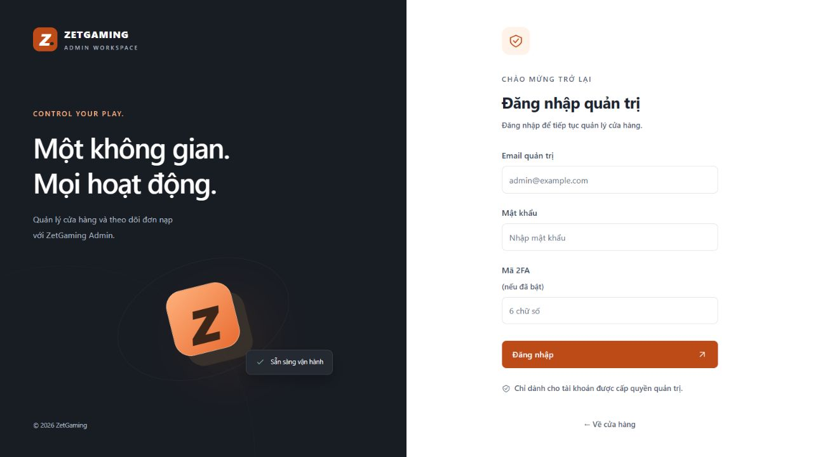
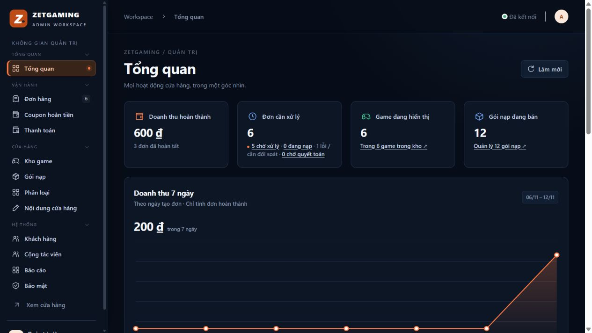
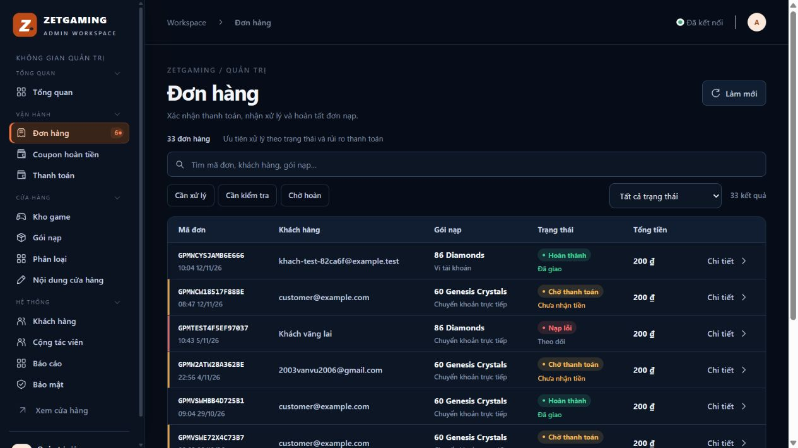
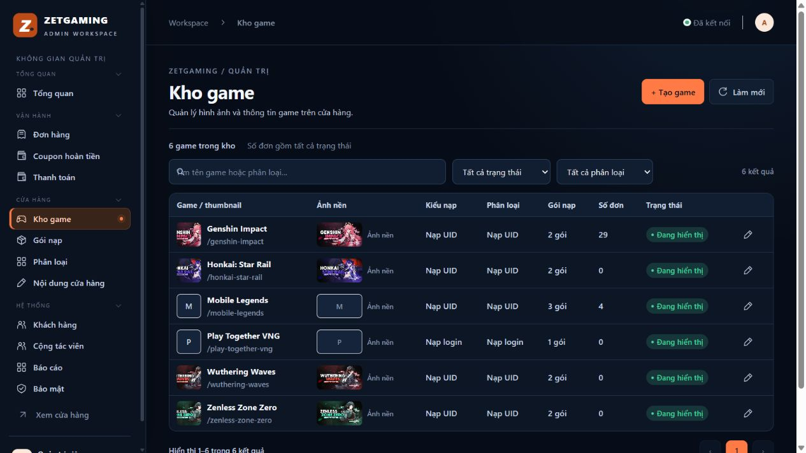
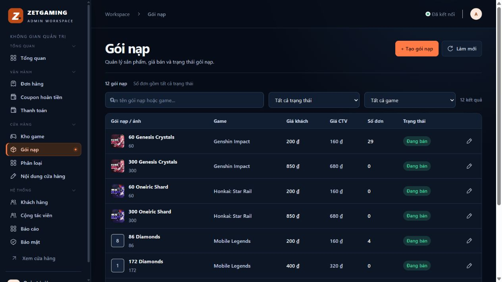

# Cẩm nang sử dụng ZetGaming Admin

> Tài liệu này dành cho người vận hành cửa hàng. Admin chạy tại `http://localhost:4174` trong môi trường local.

## 1. Đăng nhập



1. Mở `http://localhost:4174/login`.
2. Nhập email và mật khẩu tài khoản quản trị.
3. Nếu tài khoản đã bật 2FA, nhập thêm mã 6 chữ số từ ứng dụng xác thực.
4. Bấm **Đăng nhập**.

Tài khoản admin mới được phép vào khu vực này. Khi dùng xong, bấm nút đăng xuất ở cuối thanh menu bên trái.

## 2. Tổng quan



Màn hình **Tổng quan** giúp biết cửa hàng đang có gì cần xử lý:

- **Doanh thu hoàn thành**: tổng tiền của các đơn đã hoàn tất.
- **Đơn cần xử lý**: các đơn đang chờ nhận, đang nạp hoặc cần đối soát.
- **Game đang hiển thị**: số game đang bật trên trang khách.
- **Gói nạp đang bán**: số gói đang hoạt động.

Bấm các liên kết trong từng ô để đi thẳng tới danh sách tương ứng. Nút **Làm mới** tải lại số liệu mới nhất.

## 3. Xử lý đơn hàng



1. Mở **Đơn hàng** ở menu trái.
2. Dùng ô tìm kiếm để tìm theo mã đơn, email khách hoặc tên gói.
3. Dùng các nút **Cần xử lý**, **Cần kiểm tra**, **Chờ hoàn** hoặc bộ lọc trạng thái để thu hẹp danh sách.
4. Bấm **Chi tiết** ở cuối dòng để xem đơn.
5. Kiểm tra đúng game, gói nạp, số tiền và thông tin người chơi.
6. Chỉ nhận xử lý khi đã xác nhận thanh toán. Sau khi nạp xong, xác nhận kết quả trong hộp chi tiết.

Không đánh dấu hoàn thành khi chưa kiểm tra kết quả nạp. Nếu giao dịch có vấn đề, chuyển sang luồng cần kiểm tra hoặc báo lỗi theo trạng thái đang hiển thị.

## 4. Quản lý kho game



1. Mở **Kho game**.
2. Bấm **Tạo game** để thêm game mới.
3. Tìm game bằng tên hoặc phân loại; có thể lọc theo trạng thái và phân loại.
4. Bấm biểu tượng chỉnh sửa ở cuối dòng để sửa tên, ảnh, kiểu nạp, phân loại hoặc trạng thái hiển thị.
5. Bấm lưu và kiểm tra lại trạng thái **Đang hiển thị**.

Tắt trạng thái hiển thị sẽ ẩn game khỏi trang khách nhưng không xóa dữ liệu game và các gói đã tạo.

## 5. Quản lý gói nạp



1. Mở **Gói nạp**.
2. Dùng tìm kiếm hoặc lọc theo trạng thái/game.
3. Bấm **Tạo gói nạp** để thêm sản phẩm.
4. Chọn game, nhập tên gói và giá bằng VNĐ.
5. Nhập giá khách, giá CTV, nhãn nếu cần, rồi chọn **Đang bán**.
6. Với gói đã có, bấm biểu tượng chỉnh sửa ở cuối dòng và lưu lại.

Giá nhập trên giao diện là VNĐ. Không nhập thêm dấu chấm, dấu phẩy hoặc ký hiệu tiền tệ vào ô số.

## 6. Các khu vực khác

- **Coupon hoàn tiền**: xem và thu hồi coupon được phát hành từ các đơn lỗi.
- **Thanh toán**: kiểm tra cấu hình và thông tin thanh toán của cửa hàng.
- **Phân loại**: tạo, đổi tên và sắp xếp nhóm game.
- **Nội dung cửa hàng**: cập nhật banner và nội dung hiển thị ở trang khách.
- **Khách hàng**: xem tài khoản, khóa/mở tài khoản và quản lý hạng khách.
- **Cộng tác viên**: xem danh sách CTV và phân đơn phù hợp.
- **Báo cáo**: theo dõi số liệu đơn hàng, doanh thu và hoàn tiền.
- **Bảo mật**: bật 2FA và đổi mật khẩu admin.

## 7. Chạy toàn bộ hệ thống local

Mở các terminal riêng trong thư mục dự án:

```powershell
npm run db:local
npm run backend
npm run dev
npm run admin:dev
```

Sau đó mở:

- Admin: `http://localhost:4174`
- Cửa hàng: `http://localhost:4173`
- API: `http://localhost:4180`

Nếu admin báo mất phiên, tải lại trang và đăng nhập lại. Nếu không kết nối được dữ liệu, kiểm tra PostgreSQL và backend trước, rồi mới khởi động lại admin.
