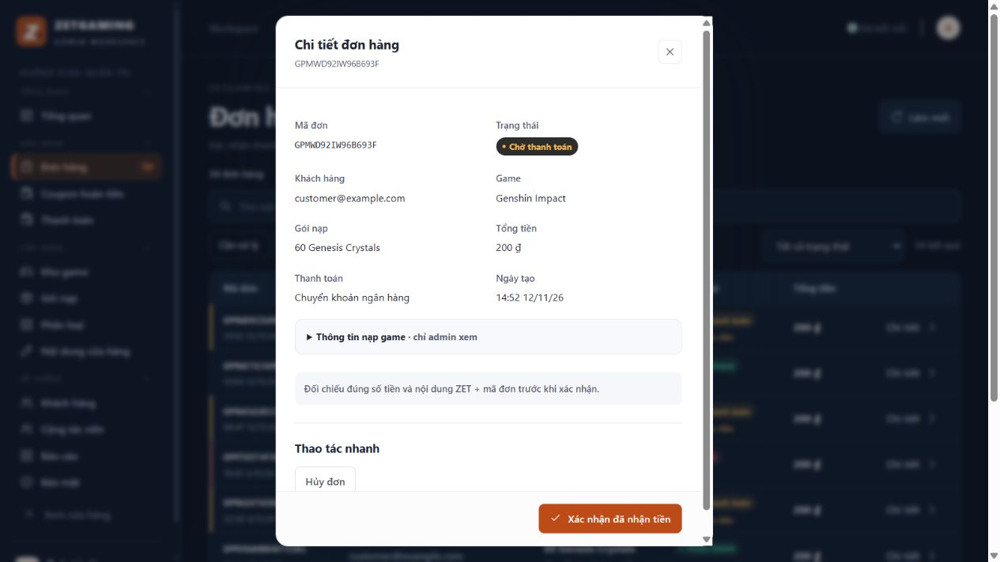
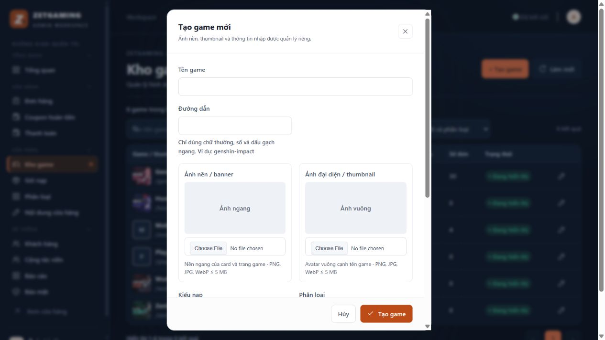
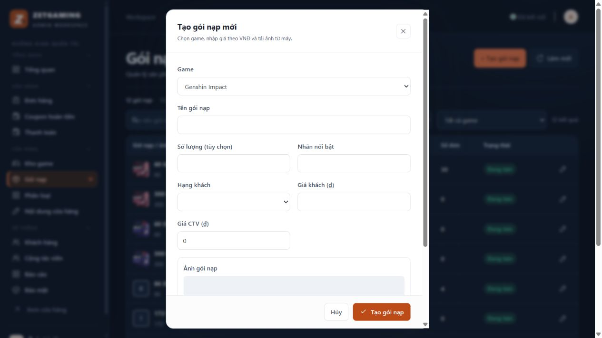
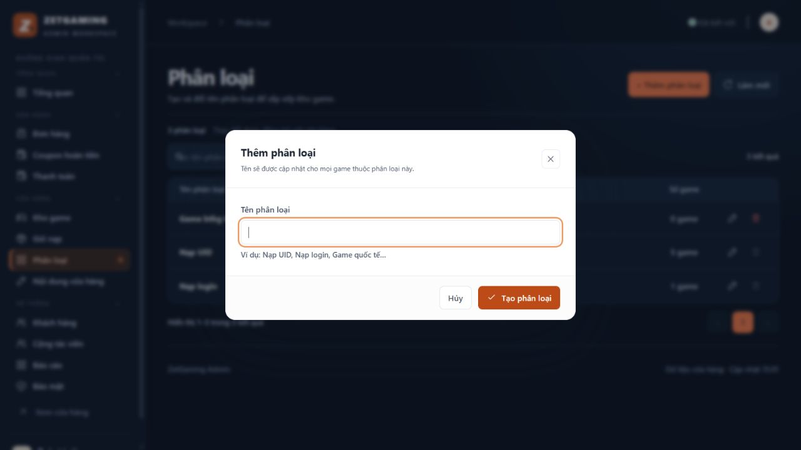
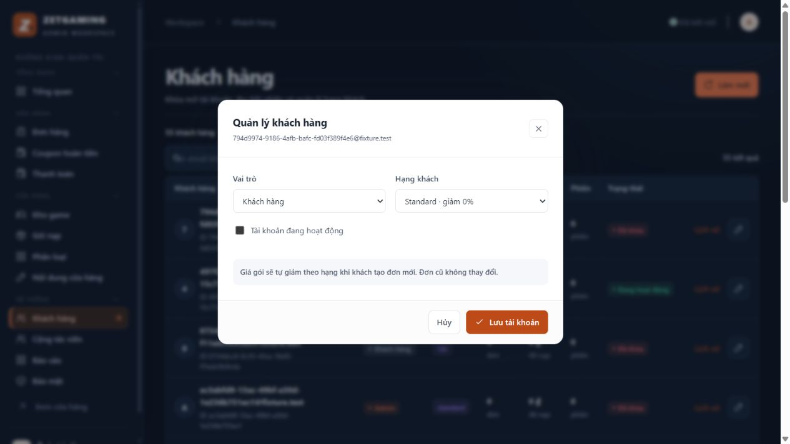
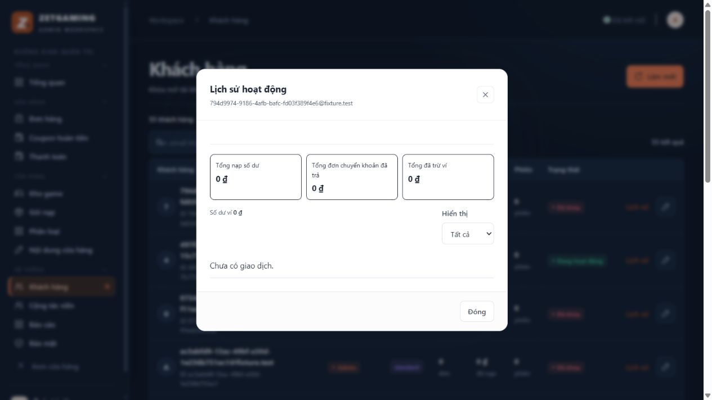
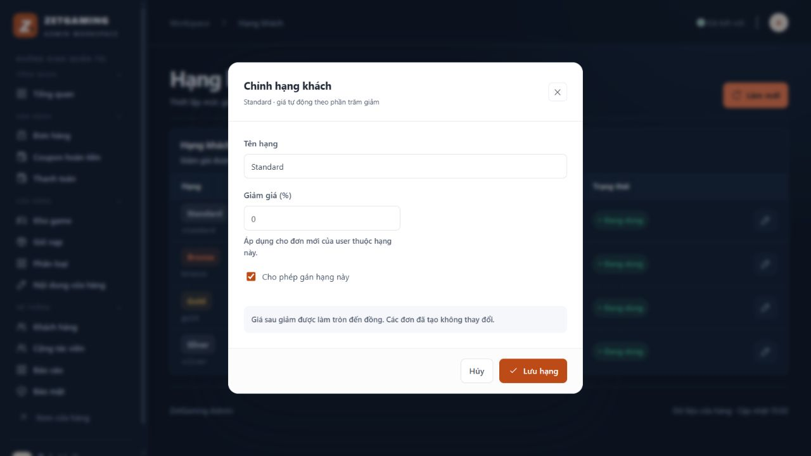

# ZetGaming Admin - Product Handbook

> Bản hướng dẫn vận hành đầy đủ theo product hiện tại: toàn bộ 13 màn hình, form, trạng thái đơn, quyền, thanh toán, bảo mật và cách phục hồi lỗi.

## 0. Phạm vi sản phẩm

ZetGaming Admin là workspace để vận hành cửa hàng nạp game. Bốn nhóm chính:

- **Tổng quan:** số liệu, doanh thu, việc cần làm.
- **Vận hành:** đơn hàng, coupon hoàn tiền, thanh toán/nạp ví.
- **Cửa hàng:** game, gói nạp, phân loại, banner.
- **Hệ thống:** khách hàng, CTV, hạng khách, báo cáo, bảo mật.

Địa chỉ local: Admin `http://localhost:4174`, storefront `http://localhost:4173`, API `http://localhost:4180`.

### Nguyên tắc thao tác

1. Không complete đơn nếu chưa xác nhận đúng target và kết quả nạp.
2. Mọi thay đổi giá, ảnh, trạng thái phải reload kiểm tra lại ở giao diện và storefront.
3. Không xóa phân loại còn game; không xóa hoặc hoàn đơn khi chưa kiểm tra liên kết ledger/provider.
4. Ảnh upload chỉ nhận PNG, JPG, WebP tối đa 5 MB.
5. Giá nhập là VNĐ; nhập `20000`, không nhập `20.000 đ`.

## 1. Bản đồ chức năng

| Nhóm | Màn hình | Mục đích | Tần suất |
|---|---|---|---|
| Tổng quan | Tổng quan | Điều phối số liệu và việc cần làm | Mỗi ca |
| Vận hành | Đơn hàng | Nhận, nạp, hoàn tất, lỗi, hoàn tiền | Liên tục |
| Vận hành | Coupon hoàn tiền | Theo dõi mã hoàn cho khách vãng lai | Khi có lỗi |
| Vận hành | Thanh toán | VietQR và đối soát nạp ví | Hằng ngày |
| Cửa hàng | Kho game | Game, ảnh, mode, target fields | Khi mở rộng kho |
| Cửa hàng | Gói nạp | Sản phẩm, giá, trạng thái bán | Hằng ngày |
| Cửa hàng | Phân loại | Gom game theo nhóm | Theo nhu cầu |
| Cửa hàng | Nội dung | Banner và nội dung trang chủ | Theo chiến dịch |
| Hệ thống | Khách hàng | Role, hạng, khóa/mở, lịch sử | Khi hỗ trợ |
| Hệ thống | CTV | Danh sách và số dư CTV | Theo ca |
| Hệ thống | Hạng khách | Giảm giá đơn mới | Theo chính sách |
| Hệ thống | Báo cáo | Doanh thu, đơn, hoàn tiền | Cuối kỳ |
| Hệ thống | Bảo mật | 2FA, mật khẩu, phiên | Định kỳ |

## 2. Đăng nhập và phiên

1. Mở `/login`, nhập email và mật khẩu tối thiểu 8 ký tự.
2. Nếu đã bật 2FA, nhập mã 6 chữ số.
3. Bấm **Đăng nhập**. Chỉ role `admin` được vào workspace.
4. Kiểm tra topbar có **Đã kết nối**, sidebar có email admin và avatar.
5. Khi xong việc, bấm **Đăng xuất** ở cuối sidebar.

Lỗi thường gặp: sai thông tin thì kiểm tra lại tài khoản; mất quyền thì dùng đúng admin; mất kết nối thì kiểm tra PostgreSQL/backend; mất phiên thì tải lại login và đăng nhập lại. Không cố phục hồi bằng Back hoặc tắt CSRF.

## 3. Tổng quan - màn hình điều phối

Các vùng của màn hình:

- **Doanh thu hoàn thành:** tổng tiền và số đơn completed.
- **Đơn cần xử lý:** pending, processing, lỗi/cần đối soát, chờ quyết toán.
- **Game đang hiển thị / Gói nạp đang bán:** active so với tổng kho.
- **Doanh thu 7 ngày:** chỉ tính đơn hoàn thành theo ngày tạo.
- **Cần bạn xử lý:** shortcut tới đúng bộ lọc trạng thái.
- **Đơn hàng gần đây:** 5 giao dịch mới, mở được chi tiết.

Thứ tự đọc chuẩn: xử lý đơn đã thanh toán -> kiểm tra processing -> xử lý needs_review/failed -> giải quyết refund_pending -> xem awaiting_payment. Nút **Làm mới** gọi lại dữ liệu; thời gian cập nhật ở chân trang.

## 4. Đơn hàng

### 4.1. Bảng và bộ lọc

Cột gồm mã đơn, khách hàng, gói nạp/phương thức thanh toán, trạng thái, tổng tiền và chi tiết. Tìm kiếm theo mã/email/tên gói; shortcut gồm **Cần xử lý**, **Cần kiểm tra**, **Chờ hoàn**; select lọc trạng thái; phân trang giữ số kết quả và trang hiện tại.

### 4.2. Vòng đời nghiệp vụ

`awaiting_payment` -> `pending_admin` -> `processing` -> `completed`

Nhánh ngoại lệ: processing -> `needs_review` hoặc `failed`; failed -> pending_admin bằng **Thử lại** nếu chưa hoàn/cấp coupon; pending_admin/awaiting_payment/failed -> `cancelled`; cancelled -> `refund_pending` -> `refunded` với chuyển khoản; cancelled -> refunded ngay với hoàn về ví.

### 4.3. Nhận và hoàn tất

1. Mở chi tiết đơn pending.
2. Kiểm tra payment, game, package, số tiền và toàn bộ target.
3. Bấm **Nhận xử lý**; từ lúc này admin hiện tại là người chịu trách nhiệm.
4. Nạp đúng target, kiểm tra vật phẩm/số dư phía game.
5. Chỉ sau khi xác nhận thành công mới bấm **Hoàn tất**.

Nếu có mapping provider/auto-fulfill, nhận đơn có thể tạo lệnh upstream. Provider không xác nhận thì giữ needs_review, không đánh dấu đã giao.

### 4.4. Lỗi, đối soát và thử lại

- **Kết quả chưa rõ:** nhập lý do, chuyển needs_review.
- **Chưa giao vật phẩm:** xác nhận rõ chưa giao, chuyển failed.
- **Cần kiểm tra:** admin đang giữ đơn chọn **Đã giao** hoặc **Chưa giao**.
- **Thử lại:** chỉ dùng cho failed chưa có refund/coupon; phải nhập lý do và xác nhận.

Đơn user trả ví có thể được hoàn tự động vào ví khi provider thất bại. Đơn khách vãng lai trả trực tiếp có thể sinh coupon theo giá trị gốc.

### 4.5. Hủy, ghi nhận tiền muộn và hoàn

- **Hủy:** nhập lý do; provider-managed phải đối soát provider trước.
- **Ghi nhận thanh toán muộn:** chỉ cho direct order đã hủy, chưa paid, cần mã tham chiếu.
- **Yêu cầu hoàn:** direct order đã hủy và đã paid -> refund_pending.
- **Xác nhận hoàn:** nhập reference ngân hàng -> refunded.
- **Hoàn ví:** hệ thống kiểm tra ledger purchase trước khi cộng tiền lại.
- **Ghi chú:** lưu bằng chứng và bối cảnh; không ghi mật khẩu/secret.

Không tạo refund lần hai khi đã có ledger refund, coupon hoặc order_refund.

## 5. Coupon hoàn tiền

Coupon sinh từ đơn khách vãng lai lỗi có ba trạng thái: **Đang dùng được**, **Đã sử dụng**, **Đã thu hồi**. Bảng có mã, giá trị, đơn nguồn, đơn sử dụng, trạng thái, ngày tạo. Link đơn nguồn đưa về order detail. Chỉ mã active mới có nút **Thu hồi**; thu hồi là một chiều.

Quy trình: mở đơn nguồn -> xác nhận payment và lý do lỗi -> kiểm tra coupon -> gửi mã qua kênh hỗ trợ -> khi khách báo lỗi, kiểm tra mã đã dùng/thu hồi chưa.

## 6. Thanh toán và nạp ví

Khu cấu hình hiển thị ngân hàng đã cấu hình, tên ngân hàng, số tài khoản che một phần, provider QR và chế độ đối soát. Không gửi số tài khoản đầy đủ ra ngoài workspace.

Bảng nạp ví có trạng thái **Chờ thanh toán**, **Đã cộng ví**, **Đã hủy**. Khi khách báo đã chuyển:

1. Đối chiếu số tiền, nội dung, thời gian với ngân hàng.
2. Bấm **Đã nhận tiền**.
3. Nhập mã tham chiếu nếu có.
4. Kiểm tra trạng thái đã cộng ví.

Không cộng ví chỉ dựa vào ảnh khách gửi khi chưa xác minh giao dịch.

## 7. Kho game

### Form game

- **Tên game:** tên hiển thị.
- **Slug:** chữ thường, số, dấu gạch ngang; cố định sau khi tạo.
- **Ảnh nền/banner:** ảnh ngang, bắt buộc khi tạo.
- **Thumbnail:** ảnh vuông cạnh tên game.
- **Kiểu nạp:** UID hoặc login.
- **Phân loại:** chọn từ màn hình Phân loại.
- **Hướng dẫn nhập:** ví dụ đường đi tìm UID, tối đa 3000 ký tự.
- **Thông tin bổ sung:** mỗi dòng là một field như Máy chủ/Khu vực/Tên nhân vật.
- **Mật khẩu game:** checkbox cho mode UID nếu cần.
- **Hiển thị game:** tắt để ẩn storefront, không xóa dữ liệu.

Game login luôn yêu cầu tài khoản và mật khẩu; không thêm field trùng hai trường này. Game UID tự có UID; chỉ thêm field phụ khi cần.

### Quy trình tạo/sửa

1. Tạo phân loại nếu cần.
2. Chuẩn bị ảnh đúng chuẩn, nhập slug ổn định.
3. Chọn mode, viết guide theo ngôn ngữ khách hiểu.
4. Thêm field phụ theo thứ tự khách cần nhập.
5. Lưu, mở storefront và thử flow nạp trước khi bật chiến dịch.

## 8. Gói nạp

Trường chính: tên gói, game, nominal, giá khách, giá CTV, nhãn, ảnh gói và trạng thái **Đang bán**. Ảnh gói trống có thể dùng ảnh game theo logic hiển thị. Nhập giá dạng số VNĐ; hệ thống chuyển sang cents khi lưu.

Khi đổi giá: ghi nhận giá cũ -> sửa một gói -> reload -> kiểm tra storefront -> cập nhật các gói liên quan đồng nhất. Hạng khách chỉ giảm giá đơn mới; đơn cũ không đổi.

## 9. Phân loại

Tạo/đổi tên group để tổ chức kho. Đổi tên áp dụng cho game đang tham chiếu. Nhóm hệ thống không xóa. Category còn game không được xóa: chuyển game sang group khác hoặc Chưa phân loại trước.

## 10. Nội dung cửa hàng

Form Banner gồm eyebrow tối đa 80 ký tự, tiêu đề 120, mô tả 240, ảnh nền URL `/uploads/...` hoặc HTTPS, checkbox hiển thị và file picker. Preview hiển thị trước khi lưu.

Quy trình: chọn ảnh -> chờ preview -> xem crop desktop/mobile -> **Lưu banner** -> **Xem cửa hàng**. Ảnh lỗi cần kiểm tra URL, loại file và dung lượng.

## 11. Khách hàng

Bảng hiển thị email, role, hạng, số đơn, tổng đã nạp, phiên và trạng thái. Tìm theo email/hạng/role. **Lịch sử** gồm đơn nạp, topup và ledger; có filter Tất cả/Đơn nạp/Ví, tổng topup, tổng direct paid và tổng đã trừ ví.

Form quản lý có role Khách hàng/CTV/Admin, hạng khách và checkbox hoạt động. Đổi role là thay đổi quyền, chỉ thực hiện khi có yêu cầu rõ ràng. Đổi hạng chỉ tác động đơn mới.

## 12. Cộng tác viên

Hiển thị email CTV, role, số dư ví và link tới đơn cần phân. Đây là màn hình theo dõi đội ngũ, không phải nơi đổi giá package. Luồng CTV cũ có thể dùng `ready`, `claimed`, `review`; không trộn với luồng admin mới nếu cần đối soát riêng.

## 13. Hạng khách

Mỗi hạng có tên, mã nội bộ, phần trăm giảm, số gói có giá gốc và trạng thái. Form sửa tên, discount percent và cho phép gán hạng. Giá sau giảm làm tròn đến đồng; không hồi tố đơn cũ; không đặt mức giảm khiến giá âm.

## 14. Báo cáo

Chọn 7/30/90 ngày hoặc ngày bắt đầu/kết thúc. Báo cáo gồm số đơn, doanh thu completed, hoàn tiền và phân tích theo game/package; có thể tải CSV. Khi so với Tổng quan phải cùng kỳ ngày và timezone. Trước khi gửi CSV ra ngoài, loại bỏ dữ liệu khách không cần thiết.

## 15. Bảo mật

### 2FA

Mở Bảo mật -> enroll -> quét secret/QR bằng Google Authenticator/TOTP -> nhập mã 6 số và mật khẩu hiện tại -> bật -> đăng nhập lại để kiểm tra. Recovery secret phải lưu trong nơi bảo mật, không commit hoặc gửi nhóm chat.

### Mật khẩu và CSRF

Đổi mật khẩu cần mật khẩu hiện tại, mật khẩu mới và code 2FA nếu bật. Các POST/PATCH/DELETE cần CSRF token. Token lỗi hoặc phiên hết hạn: tải lại trang, không tắt CSRF.

## 16. Checklist vận hành

### Đầu ca

- Đăng nhập và kiểm tra 2FA.
- Mở Tổng quan, xử lý pending đã thanh toán.
- Kiểm tra processing, needs_review, failed, refund_pending.
- Đối soát topup đang chờ.

### Trong ca

- Mỗi đơn nhận xử lý phải có người chịu trách nhiệm.
- Ghi note khi có ngoại lệ.
- Không complete khi chưa thấy kết quả nạp.
- Sau đổi giá/ảnh, kiểm tra storefront.

### Cuối ca

- Không còn processing/needs_review bị bỏ quên.
- Đối chiếu failed, refund, coupon mới.
- Xuất báo cáo nếu cần.
- Đăng xuất trên máy dùng chung.

## 17. Ma trận sự cố

| Lỗi | Kiểm tra | Phục hồi |
|---|---|---|
| Bảng trống | filter, connection, updated-at | Xóa filter, Làm mới |
| Ảnh không hiện | URL, type, size | Upload lại PNG/JPG/WebP <= 5 MB |
| Form không lưu | inline error, field required | Sửa đúng thông báo, thử lại |
| Không nhận đơn | payment, assignment, status | Không nhận trùng, reload chi tiết |
| Provider mơ hồ | provider status/audit | needs_review, không complete |
| Không hủy được | processing/provider-managed | Đối soát provider |
| Không hoàn được | paid_at, ledger, refund | Kiểm tra giao dịch trước |
| Không xóa category | game_count > 0 | Chuyển game rồi xóa |
| Mất quyền admin | role/session | Đăng nhập đúng admin |

## 18. Chạy local và smoke test

```powershell
npm run db:local
npm run backend
npm run dev
npm run admin:dev
```

Kiểm tra theo thứ tự PostgreSQL -> backend -> storefront -> admin. Smoke test nên bao phủ login, đủ 13 menu, protected API, CSRF rejection, mở form, xem order, logout.

## 19. Phụ lục hỗ trợ khách

Luôn xin mã đơn, email hoặc loại khách, game/package, thời gian thanh toán, phương thức thanh toán và mô tả lỗi. Không xin hoặc gửi mật khẩu game qua kênh không an toàn; không đưa secret 2FA, token, số tài khoản đầy đủ hoặc dữ liệu ledger vào phản hồi khách.

## 20. Atlas ảnh thao tác theo từng nút và từng ô

Mỗi màn hình trong PDF có một ảnh toàn cảnh. Các ảnh dưới đây zoom vào những điểm khách thường cần bấm: tạo mới, chỉnh sửa, xem chi tiết, bộ lọc, lịch sử và nút lưu.














